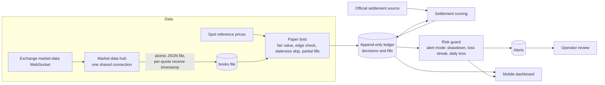

# Pricing short-horizon crypto prediction markets: a paper-trading case study

*An engineering and research write-up by Jamie Urena. Paper trading only. No strategy parameters are published here.*

**Status:** one strategy is still in paper validation. Nothing in this repo is trading advice, and no real money has been risked on it.

## Summary

Jamie, a U.S. Army veteran and former intelligence analyst, builds trading research the way he used to build assessments: state a hypothesis, collect evidence, try to break the result, and say how confident you are. This repo documents one such project: a set of paper bots that price very short-horizon crypto "up or down" prediction markets and ask a narrow question: **is the market's price different from a fair value computed from spot price, time left, and realized volatility, by enough to pay for fees?**

The most useful result so far is about method, not profit. An early version looked promising, and the cause turned out to be a stale data feed. Finding that, fixing it, and building the tooling to keep it from happening again is the part of the project I'd most want a reviewer to read.

## The problem

A prediction market contract on "will asset X finish above Y at time T" is a binary option. With minutes to expiry, its fair value can be framed the way options are priced:

- **Spot**: where the underlying trades now, relative to the level it needs to finish above.
- **Time left**: less time means less room for the price to move.
- **Realized volatility**: how far the price has recently been moving, used to estimate the spread of possible outcomes over the remaining time.

Combine those into a probability, compare it to the price the market is asking, and trade only if the gap is large enough to survive fees and uncertainty in the model. Chart-pattern technical analysis is deliberately absent. The model has to explain *why* a price is wrong in terms of quantities that can be measured and checked afterward, which makes the test falsifiable.

## Architecture

**Market-data hub.** One process owns the single WebSocket connection and publishes the latest top-of-book for every market to a small JSON file, written atomically. Each quote carries its own receive timestamp. Bots read the file rather than opening their own connections, so they all see the same data and the hub is the only thing that touches the network. A generic version of the pattern is in [`snippets/book_hub.py`](snippets/book_hub.py).

**Paper bots.** Each bot computes fair value, checks the gap to the market, and records a decision. A bot is allowed to *skip*: if the quote is too old or the book is too thin, it records the skip and does nothing. Skips are data too.

**Ledger and settlement scoring.** Every decision and fill goes into an append-only ledger. A separate step scores each trade against the market's official settlement, not against a price series reconstructed afterward, so the scoring can't quietly disagree with how the market actually resolved.

**Risk guard.** A guard reads the ledgers and evaluates three rules per lane: drawdown from peak, consecutive losses, and loss within a day. During the paper test it runs in **alert mode**: trips are logged and shown on the dashboard but never stop a bot, so the test keeps collecting unbiased data while still showing what *would* have stopped it. A one-line switch moves it to **enforce mode**, which latches a pause until a human resumes the lane. That switch is planned for the day real money is involved, not before. See [`snippets/lane_guard.py`](snippets/lane_guard.py).

**Mobile dashboard.** A small read-only web page shows each lane's state, recent decisions, and any guard alerts, so the system can be checked from a phone.

## Engineering lessons

**1. A stale order book flattered the early results.**
The first versions polled an order book over REST. The quotes were often older than they looked, and the old prices made the model's disagreement with the market look larger than it was. The first paper results were encouraging, and most of them came from that flaw. The fix had three parts:
- move to a live WebSocket feed, shared through the hub;
- stamp every quote on receipt and make staleness a *skip* condition rather than something to patch over with a fallback price;
- tag every ledger entry with its quote source, so results from the old feed and the new feed can never be blended in a single number.

After the change, the count of trades with clean provenance went back to a small number, and the project effectively restarted its evidence clock. That was the right call, and an uncomfortable one.

**2. Fills are partial at top-of-book size.**
The first simulation assumed a full fill at the displayed price. Real books don't work like that: you get what's displayed at the top, and no more. The simulator now fills only up to the visible size, which lowers both trade size and the flattering effect of oversized fills.

**3. Memory tuning on a small server.**
Long-running Python processes on a small VM drifted upward in memory. Two changes helped: limiting the allocator's arenas, and replacing "re-read the whole ledger every cycle" with an **incremental read** that only parses newly appended lines. Both are boring, and both are what keeps a long test alive.

**4. Test luck against the market, not against zero.**
A positive P&L over a small sample proves very little. The check I use asks: *if the market's own prices were fair, how often would a result this good happen by chance?* Simulate the same trades, draw each outcome at the market-implied probability, and count how often the simulated P&L matches or beats the observed one. A small share is suggestive; a large share means "could easily be luck." It is not proof of edge, and it says nothing about out-of-sample durability. Code is in [`snippets/luck_vs_edge.py`](snippets/luck_vs_edge.py).

**5. Change one thing at a time, and test the change.**
Each modification to the live paper bot (new feed, partial fills, guard hook, incremental read) was made with a backup, a rollback path, and a test that the new code reproduced the old code's decisions where it was meant to. A recalibrated variant of the model runs *side by side* with the original rather than replacing it, so the two can be compared on the same market windows.

## Results, stated plainly

- **Everything is paper.** No real orders were placed.
- **Early paper results were promising, but mostly came from the flawed feed** described above, so I don't rely on them and don't quote them.
- **The live-feed sample is small.** The current bot is still in validation, and a small sample can't separate skill from luck. A pre-agreed review point decides what happens next; moving to real money would require a separate, explicit decision.
- **Some ideas were dropped.** A chart-pattern (TA-based) BTC bot lost money after fees and was retired. A historical test on a second venue's data also lost money.
- **Fees matter more than intuition suggests.** Several candidate edges disappeared once realistic fees and partial fills were applied.

## What I'd do next

- Reach a pre-agreed number of clean, live-feed settled trades before drawing conclusions, and review once, rather than peeking.
- Keep the side-by-side calibration test running and judge it on the same windows as the baseline.
- Switch the guard to enforce mode before any real-money trade, and rehearse resume.
- Add reboot persistence and alerting for the processes, which currently depend on a manual restart after a server reboot.

## What's in this repo

| Path | What it is |
|---|---|
| `README.md` | This case study |
| `snippets/book_hub.py` | Generic shared-WebSocket hub with atomic publish and a required staleness budget |
| `snippets/lane_guard.py` | Generic alert/enforce risk guard with drawdown, loss-streak and daily-loss rules |
| `snippets/luck_vs_edge.py` | Simulation that asks how often market-implied odds would produce the observed P&L |
| `tests/test_snippets.py` | Tests for the three snippets (`pip install pytest && pytest`) |

The snippets are intentionally generic. They contain no strategy thresholds, calibration data, fee or edge parameters, or market-selection logic, and no venue-specific details or credentials. The illustrative limits in the tests are toy numbers.

## On how this was built

Built with AI-assisted development. The research questions, the risk rules, the decision to distrust and rebuild the data feed, and the judgment about luck versus edge are Jamie's; AI tools helped write and test code and draft analyses, and every change went through his review.

## Disclaimer

This is a personal research project written for education and a portfolio. It is not investment advice and not an offer of any product. Prediction markets and crypto carry substantial risk of loss.
